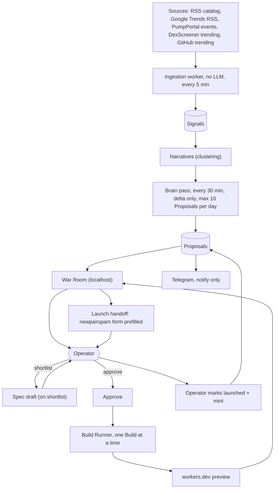
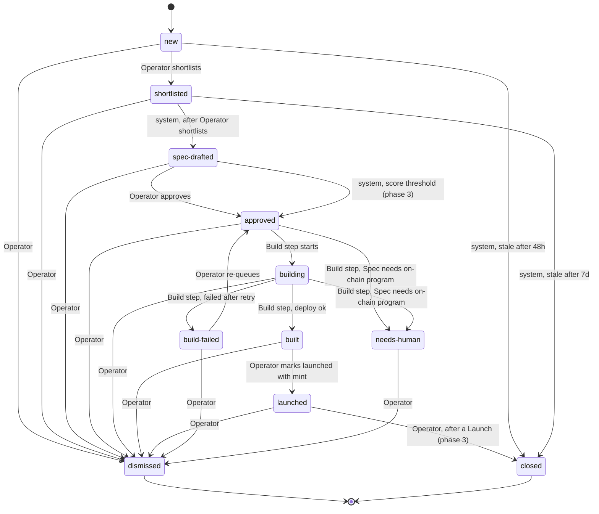

# Argus architecture and plan

Terms (Signal, Source, Narrative, Tech, Proposal, Spec, Build, Launch, Operator, Team, War Room, Dismissal, Proposal status) are defined in [`GLOSSARY.md`](../GLOSSARY.md). Decisions are recorded in [`docs/adr/`](adr/) and the journal [`.scratch/cos.md`](../.scratch/cos.md).

## 1. Purpose and the human-in-the-loop principle

Argus watches public Sources, clusters Signals into Narratives, and proposes tokens whose Tech (a new product that rides the Narrative) argus can then build. It researches, proposes and builds; it never launches. The Operator decides at every gate: shortlist, approve the Spec, dismiss, and finally Launch. The Launch happens manually in newpairspam (token deploy, trading and PnL live there). The Team is only notified (Telegram) and discusses outside the system.

Principle: every spend or irreversible step passes through one Operator decision, implemented as a single function (`approve(proposalId)`), so a score threshold can replace the click later (phase 3) without touching the rest.

## 2. System overview



Notes:

- Ingestion is plain code (fetch, normalize, dedupe, embed, cluster). No LLM runs there.
- The brain pass only looks at the delta since the last pass (new or materially changed Narratives) and is capped at 10 new Proposals per day.
- The Spec is drafted when the Operator shortlists (not at Proposal creation), and the Operator edits it in the War Room before approving.
- Launch itself is outside argus: the handoff only opens newpairspam with the form prefilled; the Operator launches there and returns to mark it.

## 3. Proposal lifecycle



| Transition | Triggered by | Notes |
|---|---|---|
| new | system | Brain pass creates the Proposal and notifies Telegram. |
| new -> closed (stale) | system | 48 h without action. Stored as `closed` with reason `stale`. |
| shortlisted -> closed (stale) | system | 7 d without action. |
| new -> shortlisted | Operator | Starts Spec drafting. |
| shortlisted -> spec-drafted | system | After the Operator shortlists, the brain `spec` task writes `spec.md`; Operator edits freely. |
| spec-drafted -> approved | Operator (via `approve()`) | One function. |
| spec-drafted -> approved | system (via `approve(store, id, "system")`) | Phase 3 score threshold, recorded with reason "Score threshold". Same function, different actor. |
| approved -> building | Build step | Dequeued FIFO by approval time, one Build at a time. |
| approved/building -> needs-human | Build step | Spec requires an on-chain program or anything not buildable unattended as a Cloudflare Workers web app (ADR 0003). |
| building -> built | Build step | After `wrangler deploy` succeeds and the preview URL responds. |
| building -> build-failed | Build step | After the one automatic retry. Stores `session_id`. |
| build-failed -> approved | Operator (`requeue` command) | Back into the Build queue; see the note below. |
| built -> launched | Operator | "Mark launched" with the mint recorded. |
| any non-closed state -> dismissed | Operator | Reachable from every state except `closed`. Dismissal with a reason; feeds the Rubric loop (phase 3). |

Notes on gaps the journal leaves to implementation: `spec-drafted` has no auto-expiry (only `new` and `shortlisted` expire); `launched -> closed` is only exercised from phase 3.

Recovery from `build-failed` (decided in ticket 08): the card shows the exact `claude --resume <session_id>` command, and the Operator can `requeue` the Proposal (`build-failed -> approved`, a transition of its own with the Operator as actor; the plain `approve` command is refused from `build-failed`). A re-queued Proposal goes to the back of the Build queue (its approval time is now) and gets a fresh Build, entering the runner like any approved Proposal. The runner refuses to build over an existing `~/code/<slug>`, and `gh repo create` would fail on the existing private repo, so before re-queueing the Operator removes both; the refusal message says so. Neither is ever deleted by argus. The per-Build home is kept for `build-failed` (so the session can be resumed) and deleted on `built` and on `dismissed`: the lifecycle module removes it when the Operator's dismissal is applied, except for a Proposal dismissed while `building`, whose home the runner removes when that Build ends (the container still has it mounted until then).

## 4. Build Runner

One Build at a time, FIFO by approval time. The brain (research) may run alongside. The Build Runner is a module in `packages/core`, driven by the worker process.

```mermaid
sequenceDiagram
  autonumber
  participant Op as Operator
  participant W as Worker (Build Runner)
  participant GH as GitHub
  participant CC as claude -p child
  participant CF as Cloudflare
  participant WR as War Room log

  Op->>W: approve(proposalId)
  W->>W: enqueue, wait for free Build slot
  W->>W: clone argus-build-template into ~/code/slug
  W->>GH: gh repo create slug (private, personal owner)
  W->>W: write Spec to the repo, disclosure footer included
  W->>CC: podman run the Build container: claude -p "/implement-spec ..." (acceptEdits, scoped allowedTools, max-budget-usd, 4h wall clock, stream-json)
  CC-->>WR: stream-json events piped to the log
  alt First attempt fails
    CC-->>W: non-zero exit or budget or time cap hit
    W->>CC: one automatic retry, failure report appended to the prompt
  end
  CC-->>W: exit code, result with session_id and total_cost_usd
  alt Build succeeds (first attempt or retry)
    W->>CF: wrangler deploy to slug.workers.dev
    CF-->>W: preview URL
    W->>W: status built, record cost per Proposal
    W-->>WR: build done notice (Phase 2: also Telegram; Phase 1 = War Room log only)
  else Retry also fails
    W->>W: status build-failed, store session_id for claude --resume in tmux
    W-->>WR: build failed notice (Phase 2: also Telegram; Phase 1 = War Room log only)
  end
```

Mechanics:

- Command shape (flags per the journal's guide facts): `claude -p "/implement-spec <proposalId>" --permission-mode acceptEdits --allowedTools "<scoped list>" --max-budget-usd <BUILD_MAX_BUDGET_USD> --output-format stream-json --verbose`, cwd `~/code/<slug>`, with a 4 h wall-clock timeout enforced by the worker (stop the container, treat as failure). The `<scoped list>` and the budget value are config in `packages/core`, set in the Phase 1 ticket. The argv is unchanged by containment; it runs as the command of a rootless podman container (ADR 0005), built by `buildPodmanRunArgs` in `packages/core/src/sandbox.ts`:
  `podman run --rm --name argus-build-<id>-<nonce> --label argus.build=<id> --label argus.role=agent --label argus.data=<id> --label argus.owner=<pid.start> --pull=never --init --log-driver=none --userns=keep-id --cap-drop=all --security-opt no-new-privileges --read-only --tmpfs /tmp:rw,noexec,nosuid,nodev,size=2g --tmpfs /var/tmp:... --tmpfs /run:...,size=64m --pids-limit=1024 --memory=8g --cpus=4 --timeout=<wall clock + 60 s> --network argus-build-net -v <repo>:<repo>:Z -v <data>/proposals/<id>/home:/home/agent:Z -w <repo> --env ... localhost/argus-build:<tag> claude <argv above>`. `podman run` stays attached, so stream-json still arrives on its stdout. The token flag is `--env CLAUDE_CODE_OAUTH_TOKEN` with no value: podman copies it from its own client environment, so it is not on any command line.
- Three containers per Build, one image (ADR 0005): `agent` as above; `install` (`pnpm install --frozen-lockfile` in a fresh export of the checked commit, same network and proxy, no token); `bundle` (`wrangler deploy --dry-run --outdir --metafile` over that export, `--network none`, no token). The `agent` and `install` containers each get a fresh egress sidecar (`node /opt/argus/egress-proxy.mjs`, on `argus-build-net` at 10.89.77.2 and on the default `podman` network) that tunnels only `api.anthropic.com:443` and `registry.npmjs.org:443`; its denials are copied into `build.log` as `argus-egress: denied <host>`. On timeout, abort and shutdown the worker runs `podman stop -t 5` then `rm -f` by name on the container and its sidecar; `--timeout` is the backstop, and worker start removes leftovers that carry this data directory's label and whose owning worker is dead. Missing podman, image, network or token refuses the Build and leaves the Proposal `approved`. Caps are 8 GiB, 4 CPUs, 1024 pids and 2 GiB `/tmp` by default, overridable with `ARGUS_BUILD_MEMORY_GIB`, `ARGUS_BUILD_CPUS`, `ARGUS_BUILD_PIDS`, `ARGUS_BUILD_TMP_GIB` (a bad value is an error).
- Scoped tools (`BUILD_ALLOWED_TOOLS` in `packages/core/src/brain.ts`): file tools plus only the shell commands `/implement-spec` needs (`git add/commit/status/diff/log/show`, `pnpm install/add/check/test/typecheck/lint`, `ls`, `mkdir`, `mv`); no bare `Bash`, no push, no deploy. The Build repo's own `.claude/settings.json` adds deny rules; `--strict-mcp-config --setting-sources project` keeps the Operator's user-level setup out. The Build container's environment is not scrubbed from the host's; it is built from nothing: exactly the variables in `containerEnv` in `packages/core/src/sandbox.ts` (`HOME=/home/agent`, `CLAUDE_CONFIG_DIR`, the proxy variables, a fixed git identity with `GIT_CONFIG_GLOBAL` and `GIT_CONFIG_SYSTEM` set to `/dev/null`, `CI=1`, the telemetry and autoupdate opt-outs, and `CLAUDE_CODE_OAUTH_TOKEN` in the `agent` container only). That token is a separate `claude setup-token` token for Builds, read from `ARGUS_BUILD_TOKEN_FILE` (default `~/.config/argus/build-token`, mode 600) on each Build and never the brain's. No `ANTHROPIC_API_KEY`, GitHub, Cloudflare or npm credential exists in any container; only the host `wrangler` and `gh` see those. The podman client itself gets only `PATH`, `HOME` and `XDG_RUNTIME_DIR`, plus the token for the `agent` container. Adding a mount, flag or variable without updating the allowlist in `containment-policy.ts` fails a test, and `pnpm verify:boot` and `pnpm verify:contain` check the policy against the dry run and real containers.
- Success is decided by argus, never by the Build's own checks: (1) the last line of the final `result` text carries no `ARGUS_` marker (README contract); (2) HEAD advanced past the Spec commit; (3) the working tree is clean; (4) `scripts/`, `.claude/`, `.github/` and the `scripts` field of `package.json` match the template commit; (5) the entry point `src/index.ts` is a real file inside the repo. Before any repo is created, and again right before deploying, the runner asks the Cloudflare API whether a Worker with the slug's name already exists and fails the Build if so (or if the account cannot be checked); it never overwrites one. The bundle is made in the `bundle` container (above), where the repo's `node_modules` exist and no host file or credential does; the host then requires every input in the esbuild metafile to lie inside the exported commit and the output directory to hold only the entry, and deploys that checked entry with the global `wrangler deploy --name <slug> --config <file> --no-bundle`. The config is written by argus (name, `main` and a compatibility date, nothing else) and the Build's own `wrangler.jsonc` is never read; no script from the repo's `node_modules` runs on the host. It crawls the preview itself (`checkDisclosure`: same-origin links from `/` plus a 404 path) and requires argus's own copy of the disclosure sentence as visible text (not in hidden, `noscript`, `template`, script or style content) on every HTML page. Only then is the Proposal `built`, with the preview URL. The Build agent can write `.git/`, so runner git never reads the machine's global or system config, and after the agent has run it never reads the repo's `.git/config`, hooks or attribute drivers either: the checks and the final push use a git directory of argus's own that borrows only the repo's objects, and the push goes to the origin URL recorded before the agent started. The Build's brain run stays open until the Proposal's terminal state, and the startup sweep also fails a `building` Proposal that has no open run, so a crash mid-deploy cannot block the queue. Host-side runner commands (git, `gh`, `wrangler`) are spawned in their own process group and a timeout or shutdown kills the whole group; everything the agent runs lives in a container's own PID namespace under `--init`, so stopping the container kills grandchildren too.
- `stream-json` lines are appended to `.data/proposals/<id>/build.log` and tailed live by the War Room. The final result line supplies `session_id` and `total_cost_usd`.
- The retry is the same command with the failure report (the error plus the last 25 lines of the Build log, each cut to 300 characters) appended to the prompt, run once. It follows any failure after the setup (the clone, the private repo and the Spec commit): a non-zero exit, the `--max-budget-usd` cap, the 4 h wall clock, an `ARGUS_BUILD_FAILED` last line (its summary is in the report), a failed check, bundle, deploy or preview crawl. It does not follow a setup failure, a worker shutdown, `needs-human` or a Proposal dismissed meanwhile. Each attempt has its own brain run (the first is closed and the second opened in one transaction), so the cap and the cost are per attempt: a Proposal can use up to twice the build budget. Before the retry the runner discards uncommitted work: from a git directory of its own that borrows only the repo's objects (so the agent's `.git/config`, hooks and attributes are never read) it resets the work tree to the repo's last commit and removes untracked files (`git clean -ffd`; ignored files such as `node_modules` stay), then replaces the repo's index with the one that produced. The retry starts from a clean tree. After the retry fails the Proposal is `build-failed` with the session of its latest run that has one (a run killed by a cap prints no result, so its session is taken from the stream's first message), and the Operator can attach in tmux on the host with `cd ~/code/<slug> && CLAUDE_CONFIG_DIR=<argus>/.data/proposals/<id>/home/.claude claude --resume <session_id>` (the session lives in the per-Build home, not in `~/.claude`). The War Room computes that text with `resumeCommand` (`sandbox.ts`) and shows it on the card of a `build-failed` Proposal. A run killed by the wall clock or a shutdown prints no result, so it records $0: the per-Proposal cost undercounts for Builds that hit the cap (up to the $25 build budget per attempt). Recovery after the retry fails is in section 3.
- The `/implement-spec` skill lives in `argus-build-template` (`.claude/skills/`) so every Build gets the same instructions, lint, CI and disclosure footer.
- A Build that is killed by budget or time cap counts as failed, and enters the retry like any other failure.
- Notifications: Telegram build notices are Phase 2; in Phase 1 (Phase 2; Phase 1 = War Room log only) the Build Runner reports only to the War Room log.
- Builds never fall back to the API backend; if the subscription window is exhausted they wait (section 5).

### Operator setup for Builds

Real Builds need these, once (ADR 0005). `pnpm check` and `--dry-run` need none of them; `pnpm verify:contain` prints SKIP without podman, the image or the network.

1. Rootless podman with subuid/subgid ranges for your user. Argus never uses a socket, root or `sudo`.
2. Build the image and create the network: `pnpm image:build`. It creates `argus-build-net` (`--internal --disable-dns`, 10.89.77.0/24, idempotent; it refuses an existing network that is not internal and DNS-less) and builds `localhost/argus-build:<tag>`, printing the tag on its last line. The worker derives the same tag from the checkout, or you set `ARGUS_BUILD_IMAGE`. The worker never builds or pulls. Re-run after bumping Claude Code, Node, pnpm, the Containerfile or the proxy.
3. Mint the Build token with `claude setup-token` (separate from the brain's) and save it as one line in `ARGUS_BUILD_TOKEN_FILE` (default `~/.config/argus/build-token`), `chmod 600`. A file readable by others, empty or multi-line is refused.
4. Optional: `ARGUS_PODMAN_BIN` for a podman at another path.
5. Check it: `pnpm verify:contain` (real containers, no claude run, dummy token, no spend) and `pnpm verify:boot`.
6. To continue a failed Build's session, run the resume command from the section above.

## 5. Brain

The `Brain` interface is the single seam for all LLM work. Callers ask for a task and get structured output plus cost.

```ts
type BrainTask = 'judge' | 'propose' | 'spec' | 'build';

interface BrainRun<T> {
  output: T;
  sessionId?: string;     // claude-code only, enables resume
  totalCostUsd: number;   // recorded per run per Proposal
  backend: 'claude-code' | 'api';
  model: string;
}

interface Brain {
  run<T>(task: BrainTask, input: BrainInput, opts?: { maxBudgetUsd?: number; resume?: string }): Promise<BrainRun<T>>;
}
```

**ClaudeCodeBrain** spawns `claude -p` as a child process, with skills in `argus/.claude/skills/` (one skill per task, invoked as `/name` in the prompt) and `--output-format json` to read `session_id` and `total_cost_usd`. Auth is a long-lived token from `claude setup-token` exported as `CLAUDE_CODE_OAUTH_TOKEN` (valid one year, paid plan). `ANTHROPIC_API_KEY` must be unset in the child environment or it wins over the subscription. The long-lived token also avoids OAuth refresh contention between concurrent children. Concurrency has no documented problem; the rate limit is shared with the Operator's own Claude usage.

**ApiBrain** uses the Anthropic SDK with the same skill markdown as the system prompt, pay-as-you-go. Same inputs, same output schema.

Routing is data (config file, overridable per task), not code branching:

| Task | Backend | Model |
|---|---|---|
| judge | claude-code | haiku |
| propose | claude-code | sonnet |
| spec | claude-code | sonnet |
| build | claude-code | sonnet |

Fallback rule: when the subscription window is exhausted (rate-limit exit from `claude -p`), `judge` and `propose` switch to `api` / `haiku` for the rest of the window. Only `judge` and `propose` fall back; `spec` and `build` stay on claude-code and wait until the window resets (builds never fall back). Total research spend is bounded by a daily quota share of about 30% of the subscription so research cannot starve builds.

Every run stores `total_cost_usd` (API runs compute it from usage) against the Proposal, so the card shows agent cost so far.

Why not cloud scheduled tasks or the Agent SDK is in ADR 0001. Reference docs (fetched 2026-11-04): https://code.claude.com/docs/en/headless.md (print mode, `--output-format`, `--allowedTools`, `--resume`, `--max-budget-usd`), https://code.claude.com/docs/en/authentication.md (`claude setup-token`, `CLAUDE_CODE_OAUTH_TOKEN`, `ANTHROPIC_API_KEY` precedence), https://code.claude.com/docs/en/routines.md (cloud scheduled tasks: 1 h minimum, fresh GitHub clone, no local files), https://code.claude.com/docs/en/scheduled-tasks.md (in-session `/loop` and CronCreate: fire only while a session runs, 7-day expiry).

## 6. Sources (v1)

All v1 Sources are unauthenticated and sit behind the `Source` interface (`id`, `label`, `poll(): Promise<NormalizedSignal[]>`, ported from helios):

| Source | Kind | Notes |
|---|---|---|
| RSS catalog | news feeds | Ported from helios `sources/rss.ts`. Feed list is data. |
| Google Trends RSS | trends | Helios `trends-feeds.ts` pattern. |
| PumpPortal events | launchpad | Ported from helios `sources/pumpportal-bonding.ts`; shows what already has a token. |
| DexScreener trending | launchpad/market | New. Also used for collision checks. |
| GitHub trending | tech | New; access method open (section 13). |

No X in v1. The helios cookie scraper is not ported. X returns later through the official API as another `Source` implementation; nothing downstream changes.

## 7. Rubric

Dimensions, scored per Narrative and carried onto its Proposal: **momentum**, **novelty**, **buildability** (hard gate: below the gate the Narrative never becomes a Proposal), **hook**, **legitimacy**. Weights are equal in v1. The Rubric (dimension descriptions, weights, gate) is editable data in the War Room and stored in the datastore, not in code. The brain `judge` task reads it at call time. New Signals on an existing Narrative trigger a re-score; every Score is stored, so history is kept and shown in the details view.

## 8. War Room

Localhost only, single Operator, no auth in v1.

**Proposal card**: Narrative summary (2 lines), Tech one-liner, "why now", Score bars per Rubric dimension, 3 to 5 evidence links, collision checks (DexScreener by name and ticker, GitHub by repo name), proposed name and ticker, Narrative age, agent cost so far, Proposal status.

**Details view**: full evidence, Score history, Signals, brain run log and costs, Spec, Build log and preview link.

**Spec editor**: a textarea over `spec.md` plus "ask the agent to revise" (each turn is `claude -p --resume <session_id>` against the Spec session).

**Actions**: shortlist, approve, dismiss (with a reason), Launch (opens newpairspam with the form prefilled from name, ticker, description, logo and preview link), mark launched (records the mint). The Launch button is enabled only in `built`.

**Telegram**: one bot, one Team chat, notifications only (no commands, no reply-to-approve): new Proposal cards, build start, build done, build failed.

## 9. Stack and repo layout

pnpm TypeScript monorepo. Conventions follow the user's global setup: TypeScript 7 native compiler (`typescript` 7.x pinned to an exact version), typecheck script `tsc --noEmit --checkers 1`, vitest, incremental build info under `node_modules/.cache/` only if warm runs are measurably faster. Type-check and test once before committing.

```
argus/
  apps/
    worker/        long-running process: ingest, scheduler, brain and build children, Telegram
    warroom/       Nuxt 4 + Nuxt UI 4
  packages/
    core/          datastore, sources, brain (interface + backends), build runner, rubric
  .claude/skills/  judge, propose, spec (ClaudeCodeBrain skills)
  .data/           gitignored: argus.db, proposals/<id>/{spec.md,build.log}
  docs/  GLOSSARY.md  .scratch/
```

- Datastore: SQLite via `node:sqlite`, WAL so the worker writes while the War Room reads, additive idempotent migrations (`ensureColumn` pattern from helios).
- Specs are markdown files at `.data/proposals/<id>/spec.md`; the database stores path and hash.
- One long-running worker process (systemd user service or pm2) owns the state machine, the 5 min ingest tick, the 30 min brain tick, expiry and the Build queue. No cron. Ticks are guarded against re-entrancy (helios `reentrant.ts`).
- Brain and Build children are spawned by the worker, not by the War Room. The War Room talks to the worker through the datastore (command rows such as "approve requested") so there is one writer of state transitions.
- Token assets: name, ticker and description come from the brain `propose` task with the collision check. The logo is a template SVG placeholder in v1.
- Build outputs: `~/code/<slug>` locally, a private GitHub repo under the personal owner, preview at `<slug>.workers.dev`. Domains are bought by the Operator, not argus.

## 10. Invariants

Carried from the superseded launch pipeline plan (section 3) and adapted:

1. **Keys never in the repo.** Claude OAuth token, Telegram token, GitHub and Cloudflare credentials live in git-ignored `.env` or the OS secret store. Agents never print them. Build agents run in a rootless podman container (ADR 0005) whose environment is an allowlist: the only credential inside is the separate Build token (`CLAUDE_CODE_OAUTH_TOKEN`, inference only, `agent` container only); no GitHub, Cloudflare, npm or brain credential is mounted or passed, and the container's only network path is the allowlisted egress proxy. There is no uncontained Build mode.
2. **Dry-run on anything that spends.** Brain runs, Builds, repo creation and deploys all support `--dry-run` (log the command, spawn nothing). Exercised before real runs.
3. **Spend caps in code.** Per brain run `--max-budget-usd`; a daily research share of about 30% of the subscription; per-Build budget and the 4 h wall clock. Hitting a cap fails the run; it is never silently raised.
4. **Disclosure on every Build.** The template carries a footer stating the project was created by argus and the creator may sell; the Build Runner verifies it exists before `built`.
5. **Argus never deploys tokens.** No wallet, no pump.fun calls, no keys for chains. Launch is manual in newpairspam (ADR 0002).
6. **No fake organic interest.** Argus does no posting, botting or promotion.

## 11. Ported from helios, and not

Ported (copied and adapted, not forked or shared as a package):

- `Source` interface and the RSS adapter (`packages/core/src/sources/rss.ts`), including its time-bounded fetch.
- PumpPortal adapter (`sources/pumpportal-bonding.ts`) and trends feeds (`trends-feeds.ts`).
- Clustering and embedding approach (`clustering.ts`, `embedding.ts`) for Narratives.
- Datastore pattern (`datastore.ts` head): `node:sqlite`, WAL, additive `ensureColumn` migrations, single file shared by worker and War Room.
- Worker tick loop with the re-entrancy guard (`apps/worker/src/reentrant.ts`, not in `packages/core`).
- War Room layout ideas (`docs/design/war-room.md`): scan, read in place, act, without leaving the page.
- The Rubric and feedback labels idea (dismiss as negative, launch as positive).

Not ported:

- X cookie scraper and burner-account machinery (helios ADR-0002 territory).
- Grok / OpenRouter judge (replaced by the Brain).
- The launcher and launch profiles (newpairspam's job).
- Helios `Event` naming; argus uses Narrative.

## 12. Phases

**Phase 1 - Build path end to end with a hand-entered Proposal.**
Scope: monorepo skeleton and tooling; datastore with Proposal, Spec, brain-run and Build tables; Proposal lifecycle module with `approve()`; War Room list, Proposal card and details view, Spec editor (textarea plus revise via `--resume`); `argus-build-template` repo (Workers web app, `/implement-spec` skill, lint, CI, disclosure footer); Build Runner (clone, `gh repo create`, spawn, stream-json log, retry, build-failed with `session_id`, FIFO queue, 4 h cap); `wrangler deploy` preview; cost capture from `total_cost_usd`; Brain interface with ClaudeCodeBrain only. Telegram is phase 2.
Definition of done: the Operator enters a Proposal by hand, shortlists it, edits the Spec, approves, and without further input ends with a private GitHub repo, a working `<slug>.workers.dev` preview, status `built`, and agent cost on the card; a forced failure produces one retry then `build-failed` with a resumable `session_id`; an on-chain Spec ends in `needs-human`; a dry-run mode exists; budget and wall-clock caps are tested.

**Phase 2 - Research port.**
Scope: Sources (RSS, Google Trends, PumpPortal, DexScreener, GitHub trending), Signal dedupe and clustering into Narratives, Rubric storage and War Room editor, brain `judge` and `propose` with the ApiBrain fallback and routing config, 30 min delta pass with the 10 per day cap, collision checks, Telegram new-Proposal notifications, expiry (48 h and 7 d), re-score with history, Launch handoff and mark launched.
Definition of done: left running for 48 h unattended, argus produces at most 10 Proposals per day from live Sources, every card shows all fields from section 8, stale Proposals close on schedule, a forced subscription exhaustion switches judge/propose to the API and builds wait, and a Proposal can go from card to marked launched using only the War Room and newpairspam.

**Phase 3 - Feedback and the auto-ladder.**
Scope: Dismissal with reason feeding a Rubric review loop, outcome entry (price or holder snapshot after a Launch) to close Proposals, auto-spec for top-scored Proposals, auto-approve above a Score threshold through the same `approve()`.
Definition of done: dismissal reasons visibly adjust the suggested Rubric; outcomes are recorded for launched Proposals; auto-spec and auto-approve are each behind an off-by-default config switch with a daily cap. Auto-launch through a newpairspam API is explicitly out of scope.

## 13. Open questions

- Max-plan numeric limits are unconfirmed. Measure real usage in Phase 1 and size the 30% research share from it.
- Whether `claude -p` keeps drawing from the subscription: a support article from October 2026 says yes, re-check before relying on it, and keep ApiBrain working.
- GitHub trending access method: HTML scrape of github.com/trending or an unofficial/API route; decide in Phase 2.
- newpairspam prefill mechanism: query params or pasted JSON. Check `TokenForm.vue` in newpairspam before building the Launch button; a small newpairspam change may be needed.
