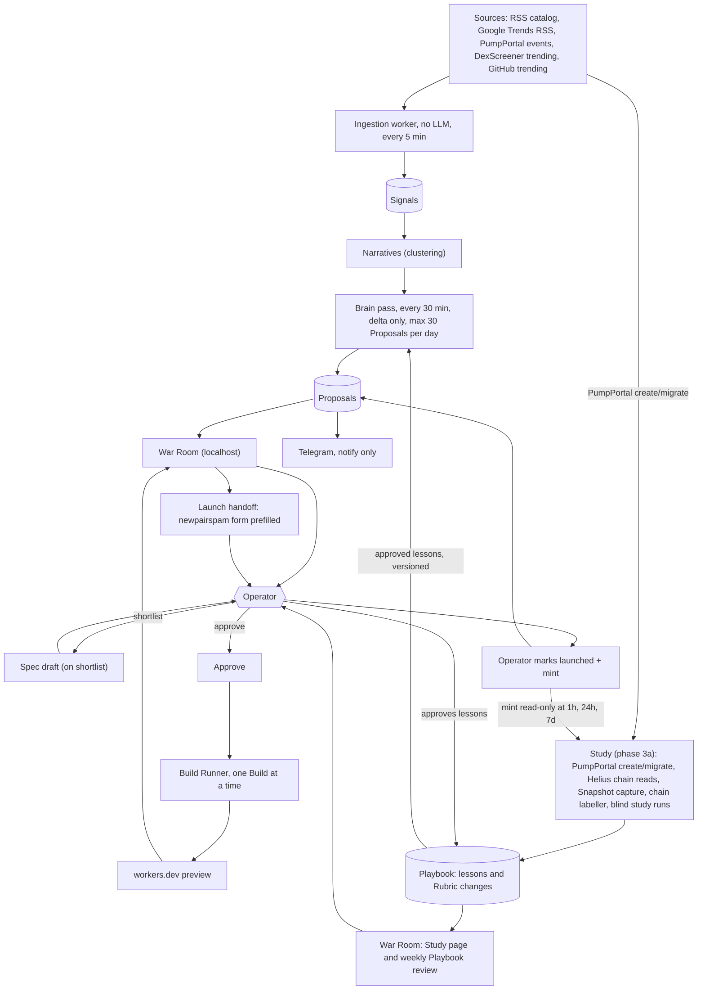
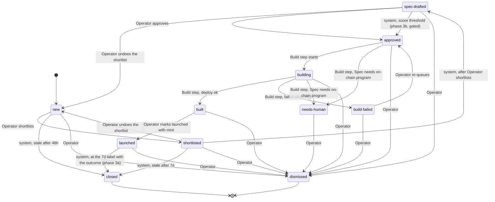
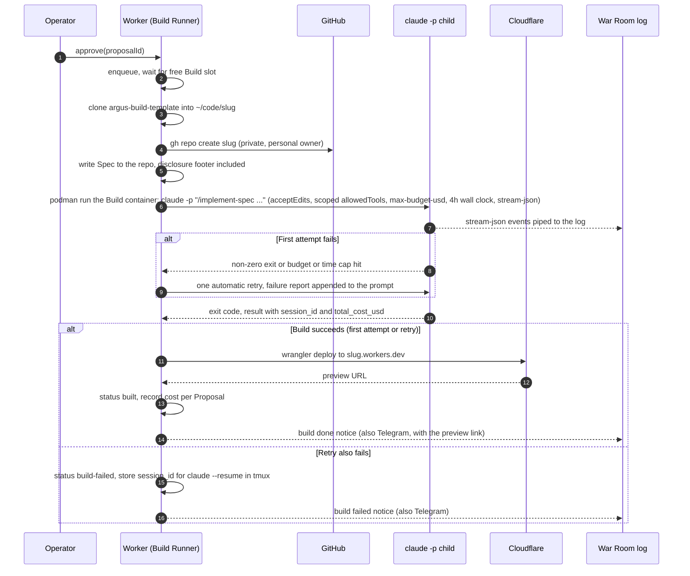

# Argus architecture and plan

Terms (Signal, Source, Narrative, Tech, Proposal, Spec, Build, Launch, Operator, Team, War Room, Dismissal, Proposal status, Study, Snapshot, Case, Cohort, Playbook, Organic migration, Fast migration) are defined in [`GLOSSARY.md`](../GLOSSARY.md). Decisions are recorded in [`docs/adr/`](adr/) and the journal [`.scratch/cos.md`](../.scratch/cos.md).

## 1. Purpose and the human-in-the-loop principle

Argus watches public Sources, clusters Signals into Narratives, and proposes tokens whose Tech (a new product that rides the Narrative) argus can then build. It researches, proposes and builds; it never launches. The Operator decides at every gate: shortlist, approve the Spec, dismiss, and finally Launch. The Launch happens manually in newpairspam (token deploy, trading and PnL live there). The Team is only notified (Telegram) and discusses outside the system.

Principle: every spend or irreversible step passes through one Operator decision, implemented as a single function (`approve(proposalId)`), so a score threshold can replace the click later without touching the rest. That replacement is phase 3b only: `approve()` with actor `system` is reachable only behind an off-by-default config switch with a daily cap, and only after the 3b gate (section 12).

## 2. System overview



Notes:

- Ingestion is plain code (fetch, normalize, dedupe, embed, cluster). No LLM runs there.
- The brain pass only looks at the delta since the last pass (new or materially changed Narratives) and is capped at 30 new Proposals per day.
- The Spec is drafted when the Operator shortlists (not at Proposal creation), and the Operator edits it in the War Room before approving.
- Launch itself is outside argus: the handoff only opens newpairspam with the form prefilled; the Operator launches there and returns to mark it.
- The Study (phase 3a) is a second pipeline beside the brain pass. It learns which of Narrative, Identity and Tech go with Organic migration on pump.fun, and it never creates Proposals. Stages, all plain code except the study runs:
  1. Create and migrate events from the existing PumpPortal connection (one WebSocket only; `uri` and raw event fields are kept), with event times and labels read from chain (Helius, read-only).
  2. A Snapshot of each token in the population (metadata names a website or X link), frozen at a fixed age: metadata and website at 60 s after create (plain fetch, SSRF guard), X at 5 min (window 5 to 15 min) by a Playwright script in the dedicated logged-in Chrome directory (ADR 0009), about 200 captures per day. No Claude in the capture path.
  3. A chain labeller at 24h (provisional) and 7d (final). The 7d label makes a Case (Snapshot plus outcome bucket); Cases group into weekly Cohorts. Buckets are control, organic migrator and bot-driven migrator (five-check bot filter on raw stored metrics, from our own Helius-based labeller), plus the Fast flag: migrated within 60 s of creation, measured by slice 1 (`.scratch/phase-3-feedback/measurements.md`).
  4. Blind study runs: the `study` Brain task reads one Snapshot as untrusted data, never the label; aggregation into lesson candidates is plain code.
  5. The Playbook (lessons and suggested Rubric changes) is reviewed weekly by the Operator in the War Room. Approved lessons are rendered into the judge and propose prompts at call time, with the Playbook version (section 7).
- The Operator's own Launches are read from chain after "mark launched" and tracked as outcomes only, kept out of Cohort statistics.

## 3. Proposal lifecycle



| Transition | Triggered by | Notes |
|---|---|---|
| new | system | Brain pass creates the Proposal and notifies Telegram. |
| new -> closed (stale) | system | 48 h without action. Stored as `closed` with reason `stale`. |
| shortlisted -> closed (stale) | system | 7 d without action. |
| new -> shortlisted | Operator | Starts Spec drafting. The War Room asks for confirmation first (a modal: it starts one paid Sonnet run). |
| shortlisted -> spec-drafted | system | After the Operator shortlists, the brain `spec` task writes `spec.md`; Operator edits freely. |
| shortlisted/spec-drafted -> new | Operator (`undo-shortlist` command) | "Undo shortlist": available until the Spec is approved. Not a dismissal: no reason, no research feedback. See the note below. |
| spec-drafted -> approved | Operator (via `approve()`) | One function. |
| spec-drafted -> approved | system (via `approve(store, id, "system")`) | Phase 3b only: score threshold behind an off-by-default switch with a daily cap, recorded with reason "Score threshold". Same function, different actor. |
| approved -> building | Build step | Dequeued FIFO by approval time, one Build at a time. |
| approved/building -> needs-human | Build step | Spec requires an on-chain program or anything not buildable unattended as a Cloudflare Workers web app (ADR 0003). |
| building -> built | Build step | After `wrangler deploy` succeeds and the preview URL responds. |
| building -> build-failed | Build step | After the one automatic retry. Stores `session_id`. |
| build-failed -> approved | Operator (`requeue` command) | Back into the Build queue; see the note below. |
| built -> launched | Operator | "Mark launched" with the mint recorded. |
| launched -> closed | system (phase 3a) | At the 7d label of the Proposal's mint, argus closes the Proposal itself with the own-launch outcome fields (curve completed, migration, DexScreener market data at 1h, 24h and 7d), read-only from chain. Replaces the manual step; manual outcome entry is dropped. |
| any non-closed state -> dismissed | Operator | Reachable from every state except `closed`. Dismissal with a reason; from phase 3 the reasons are shown in their own section of the weekly Playbook review, beside the lessons. They are not Study evidence and are not approved into prompts by themselves. |

Notes on gaps the journal leaves to implementation: `spec-drafted` has no auto-expiry (only `new` and `shortlisted` expire); `launched -> closed` is only exercised from phase 3a, by the system at the 7d label. Expiry (ticket 10) runs on the worker tick, counts from the Proposal's latest transition into its current status (`status_history.at`; a later write such as a Spec edit does not extend it; `new` counts from creation instead, see Undo shortlist below), skips a Proposal with a Brain run in flight (it closes on a later tick), and the card shows the time left.

Undo shortlist (ticket 20): the Operator can take a shortlist back from `shortlisted` or `spec-drafted`. The worker applies the command in one write transaction (`Datastore.undoShortlist`): the status goes back to `new` (history: `shortlisted -> new` or `spec-drafted -> new`, actor Operator, reason "Operator undid the shortlist") and the Spec draft is discarded (path, hash, error, retry time, attempts and any queued revision cleared; `spec.md` deleted). It is refused from any other status (a `new` Proposal makes it a no-op). Spec runs execute in the worker process (`draftSpec`/`reviseSpec` call `brain.run` in-process), which registers each run's abort in a per-Proposal `RunCancels`; the undo aborts the run in flight, killing the `claude` child, and the run records itself in `brain_runs` as `cancelled` with whatever cost and session the killed child reported (0 when none), with no `spec_error` and no re-draft. Runs already finished keep their spend on the card. The worker applies commands on their own 5 s timer as well as at the start of each tick, because the tick waits for a Spec run (up to the `spec` timeout), and a cancel must not queue behind the run it cancels. Race safety: `completeSpec` re-reads the status inside its own write transaction and refuses (`new -> spec-drafted` is not a transition), so an undo that lands as the run completes either lands first (the run is recorded and nothing else happens; the `spec.md` it wrote is removed) or lands after (the Spec is discarded); a Proposal that is un-shortlisted is never flipped to `spec-drafted`. Expiry: `new` counts its 48 h from the Proposal's creation (`created_at`), not from its latest transition into `new`, so an undo does not restart the clock; the consequence is that a Proposal undone after more than 48 h since creation is closed (`stale`) by the next worker tick. `shortlisted` still counts from its latest transition, so a re-shortlist gets its own 7 days.

Recovery from `build-failed` (decided in ticket 08): the card shows the exact `claude --resume <session_id>` command, and the Operator can `requeue` the Proposal (`build-failed -> approved`, a transition of its own with the Operator as actor; the plain `approve` command is refused from `build-failed`). A re-queued Proposal goes to the back of the Build queue (its approval time is now) and gets a fresh Build, entering the runner like any approved Proposal. The runner refuses to build over an existing `~/code/<slug>`, and `gh repo create` would fail on the existing private repo, so before re-queueing the Operator removes both. The worker enforces this when it applies the command: while `~/code/<slug>` or the private GitHub repo (asked of `gh repo view`) still exists, the command is rejected (the repo counts as absent only on `gh`'s exit 1 with GitHub's own not-found text and a token that can be shown to read private repos, i.e. with the `repo` scope; GitHub answers "not found" alike for a repo that does not exist and one the token cannot see, so a token without that scope, or one that reports no scopes, gets an error naming the problem instead, and the command is retried), the Proposal stays `build-failed`, and the rejection (shown on the card) names what to remove: the local directory, the GitHub repo, and the Cloudflare Worker when the Build deployed one (`workerDeployed`). Nothing is ever deleted by argus, and a leftover repo is not reused. The per-Build home is kept for `build-failed` (so the session can be resumed) and deleted on `built` and on `dismissed`: the lifecycle module removes it when the Operator's dismissal is applied, except for a Proposal dismissed while `building`, whose home the runner removes when that Build ends (the container still has it mounted until then). A crash in between would leave that home, so worker start also removes the home of every dismissed Proposal that has no Build run alive (`sweepDismissedHomes`).

## 4. Build Runner

One Build at a time, FIFO by approval time. The brain (research) may run alongside. The Build Runner is a module in `packages/core`, driven by the worker process.



Mechanics:

- Command shape (flags per the journal's guide facts): `claude -p "/implement-spec <proposalId>" --permission-mode acceptEdits --allowedTools "<scoped list>" --max-budget-usd <BUILD_MAX_BUDGET_USD> --output-format stream-json --verbose`, cwd `~/code/<slug>`, with a 4 h wall-clock timeout enforced by the worker (stop the container, treat as failure). The `<scoped list>` and the budget value are config in `packages/core`, set in the Phase 1 ticket. The argv is unchanged by containment; it runs as the command of a rootless podman container (ADR 0005), built by `buildPodmanRunArgs` in `packages/core/src/sandbox.ts`:
  `podman run --rm --name argus-build-<id>-<nonce> --label argus.build=<id> --label argus.role=agent --label argus.data=<id> --label argus.owner=<pid.start> --pull=never --init --log-driver=none --userns=keep-id --cap-drop=all --security-opt no-new-privileges --read-only --tmpfs /tmp:rw,noexec,nosuid,nodev,size=2g --tmpfs /var/tmp:...,size=256m --tmpfs /run:...,size=64m --pids-limit=1024 --memory=8g --cpus=4 --timeout=<wall clock + 60 s> --network argus-build-net -v <repo>:<repo>:Z -v <data>/proposals/<id>/home:/home/agent:Z -w <repo> --env ... localhost/argus-build:<tag> claude <argv above>`. `podman run` stays attached, so stream-json still arrives on its stdout. The token flag is `--env CLAUDE_CODE_OAUTH_TOKEN` with no value: podman copies it from its own client environment, so it is not on any command line.
- Three containers per Build, one image (ADR 0005): `agent` as above; `install` (`pnpm install --frozen-lockfile` in a fresh export of the checked commit, same network and proxy, no token); `bundle` (`wrangler deploy --dry-run --outdir --metafile` over that export, `--network none`, no token). The `agent` and `install` containers each get a fresh egress sidecar (`node /opt/argus/egress-proxy.mjs`, on `argus-build-net` at 10.89.77.2 and on the default `podman` network) that tunnels only `api.anthropic.com:443` and `registry.npmjs.org:443`; its denials are copied into `build.log` as `argus-egress: denied <host>`. On timeout, abort and shutdown the worker runs `podman stop -t 5` then `rm -f` by name on the container and its sidecar, each call bounded (a hung podman is killed, noted in the Build log and passed over, and the host-side process group is killed regardless); an abort also cuts short the sidecar start and its `logs` polls; `--timeout` is the backstop, and worker start removes leftovers that carry this data directory's label and whose owning worker is dead. Missing podman, image, network or token refuses the Build and leaves the Proposal `approved`. Caps are 8 GiB, 4 CPUs, 1024 pids and 2 GiB `/tmp` by default (plus a fixed 256 MiB `/var/tmp` and 64 MiB `/run`), overridable with `ARGUS_BUILD_MEMORY_GIB`, `ARGUS_BUILD_CPUS`, `ARGUS_BUILD_PIDS`, `ARGUS_BUILD_TMP_GIB` (a bad value is an error). A tmpfs is memory, so all three tmpfs together may take at most half the memory cap (2.31 of 8 GiB by default, leaving 5.7 GiB for the processes); a combination beyond that is an error too.
- Scoped tools (`BUILD_ALLOWED_TOOLS` in `packages/core/src/brain.ts`): file tools plus only the shell commands `/implement-spec` needs (`git add/commit/status/diff/log/show`, `pnpm install/add/check/test/typecheck/lint`, `ls`, `mkdir`, `mv`); no bare `Bash`, no push, no deploy. The Build repo's own `.claude/settings.json` adds deny rules; `--strict-mcp-config --setting-sources project` keeps the Operator's user-level setup out. The Build container's environment is not scrubbed from the host's; it is built from nothing: exactly the variables in `containerEnv` in `packages/core/src/sandbox.ts` (`HOME=/home/agent`, `CLAUDE_CONFIG_DIR`, the proxy variables, a fixed git identity with `GIT_CONFIG_GLOBAL` and `GIT_CONFIG_SYSTEM` set to `/dev/null`, `CI=1`, the telemetry and autoupdate opt-outs, and `CLAUDE_CODE_OAUTH_TOKEN` in the `agent` container only). That token is a separate `claude setup-token` token for Builds, read from `ARGUS_BUILD_TOKEN_FILE` (default `~/.config/argus/build-token`, mode 600) on each Build and never the brain's. No `ANTHROPIC_API_KEY`, GitHub, Cloudflare or npm credential exists in any container; only the host `wrangler` and `gh` see those. The podman client itself gets only `PATH`, `HOME` and `XDG_RUNTIME_DIR`, plus the token for the `agent` container. Adding a mount, flag or variable without updating the allowlist in `containment-policy.ts` fails a test, and `pnpm verify:boot` and `pnpm verify:contain` check the policy against the dry run and real containers.
- Success is decided by argus, never by the Build's own checks: (1) the last line of the final `result` text carries no `ARGUS_` marker (README contract); (2) HEAD advanced past the Spec commit; (3) the working tree is clean; (4) `scripts/`, `.claude/`, `.github/` and the `scripts` field of `package.json` match the template commit; (5) the entry point `src/index.ts` is a real file inside the repo. Before any repo is created, and again right before deploying, the runner asks the Cloudflare API whether a Worker with the slug's name already exists and fails the Build if so (or if the account cannot be checked); it never overwrites one. The bundle is made in the `bundle` container (above), where the repo's `node_modules` exist and no host file or credential does; the host then requires every input in the esbuild metafile to lie inside the exported commit and the output directory to hold only the entry, and deploys that checked entry with the global `wrangler deploy --name <slug> --config <file> --no-bundle`. The config is written by argus (name, `main` and a compatibility date, nothing else) and the Build's own `wrangler.jsonc` is never read; no script from the repo's `node_modules` runs on the host. It crawls the preview itself (`checkDisclosure`: same-origin links from `/` plus a 404 path) and requires argus's own copy of the disclosure sentence as visible text (not in hidden, `noscript`, `template`, script or style content) on every HTML page. Only then is the Proposal `built`, with the preview URL. The Build agent can write `.git/`, so runner git never reads the machine's global or system config, and after the agent has run it never reads the repo's `.git/config`, hooks or attribute drivers either: the checks and the final push use a git directory of argus's own that borrows only the repo's objects, and the push goes to the origin URL recorded before the agent started. The Build's brain run stays open until the Proposal's terminal state, and the startup sweep also fails a `building` Proposal that has no open run, so a crash mid-deploy cannot block the queue. Host-side runner commands (git, `gh`, `wrangler`) are spawned in their own process group and a timeout or shutdown kills the whole group; everything the agent runs lives in a container's own PID namespace under `--init`, so stopping the container kills grandchildren too.
- `stream-json` lines are appended to `.data/proposals/<id>/build.log` and tailed live by the War Room. The final result line supplies `session_id` and `total_cost_usd`.
- The retry is the same command with the failure report (the error plus the last 25 lines of the Build log, each cut to 300 characters) appended to the prompt, run once. It follows any failure after the setup (the clone, the private repo and the Spec commit): a non-zero exit, the `--max-budget-usd` cap, the 4 h wall clock, an `ARGUS_BUILD_FAILED` last line (its summary is in the report), a failed check, bundle, deploy or preview crawl. It does not follow a setup failure, a worker shutdown, `needs-human`, a Proposal dismissed meanwhile, or a Worker name that someone else holds (checked again just before the deploy, after the claude run; no second claude run is spent on it). A failure after this Build's own `wrangler deploy` (the preview crawl, say) is retried, and the retry redeploys over the Worker the Build deployed: the Build's state records that attempt 1 deployed, and only then does the name check let an existing Worker of that name pass. Each attempt has its own brain run (the first is closed and the second opened in one transaction), so the cap and the cost are per attempt: a Proposal can use up to twice the build budget. Before the retry the runner discards uncommitted work: from a git directory of its own that borrows only the repo's objects (so the agent's `.git/config`, hooks and attributes are never read) it resets the work tree to the repo's last commit and removes untracked files (`git clean -ffd`; ignored files such as `node_modules` stay), then replaces the repo's index with the one that produced. The retry starts from a clean tree. After the retry fails the Proposal is `build-failed` with the session of its latest run that has one (a run killed by a cap prints no result, so its session is taken from the stream's `system`/`init` message, and only a UUID is stored), and the Operator can attach in tmux on the host with `cd ~/code/<slug> && CLAUDE_CONFIG_DIR=<argus>/.data/proposals/<id>/home/.claude claude --resume <session_id>` (the session lives in the per-Build home, not in `~/.claude`). The War Room computes that text with `resumeCommand` (`sandbox.ts`) and shows it on the card of a `build-failed` Proposal. A run killed by the wall clock or a shutdown prints no result, so it records $0: the per-Proposal cost undercounts for Builds that hit the cap (up to the $25 build budget per attempt). Recovery after the retry fails is in section 3.
- The `/implement-spec` skill lives in `argus-build-template` (`.claude/skills/`) so every Build gets the same instructions, lint, CI and disclosure footer.
- A Build that is killed by budget or time cap counts as failed, and enters the retry like any other failure.
- Notifications: the Build Runner reports to the War Room log and to Telegram (`notifier` in `BuildRunnerOptions`, `packages/core/src/telegram.ts`): build start, build done with the preview link, and the final build failed (not a retried first attempt). Messages are plain text, queued (bounded, oldest dropped) and sent in the background with backoff, so Telegram being slow or down never holds up a Build; the bot token is redacted from every logged error. `TELEGRAM_BOT_TOKEN` and `TELEGRAM_CHAT_ID` come from the environment or the repo-root `.env`; without them notifications are off with one warning, and a dry run logs the message instead of sending it.
- Builds never fall back to the API backend; if the subscription window is exhausted they wait (section 5).

### Operator setup for Builds

Real Builds need these, once (ADR 0005). `pnpm check` and `--dry-run` need none of them; `pnpm verify:contain` prints SKIP without podman, the image or the network.

1. Rootless podman with subuid/subgid ranges for your user. Argus never uses a socket, root or `sudo`.
2. Build the image and create the network: `pnpm image:build`. It creates `argus-build-net` (`--internal --disable-dns`, 10.89.77.0/24, idempotent; it refuses an existing network that is not internal and DNS-less) and builds `localhost/argus-build:<tag>`, printing the tag on its last line. The worker derives the same tag from the checkout, or you set `ARGUS_BUILD_IMAGE`. The worker never builds or pulls. Re-run after bumping Claude Code, Node, pnpm, the Containerfile or the proxy.
3. Mint the Build token with `claude setup-token` (separate from the brain's) and save it as one line in `ARGUS_BUILD_TOKEN_FILE` (default `~/.config/argus/build-token`), `chmod 600`. A file readable by others, empty or multi-line is refused.
4. Optional: `ARGUS_PODMAN_BIN` for a podman at another path. The worker and every script (`image:build`, `verify:contain`) read this one variable; `image:build` still accepts the old `PODMAN` when it is unset, with a deprecation warning.
5. Check it: `pnpm verify:contain` (real containers, no claude run, dummy token, no spend) and `pnpm verify:boot`.
6. To continue a failed Build's session, run the resume command from the section above.

## 5. Brain

The `Brain` interface is the single seam for all LLM work. Callers ask for a task and get structured output plus cost.

```ts
type BrainTask = 'judge' | 'propose' | 'spec' | 'build' | 'study';

interface BrainRun<T> {
  output: T;
  sessionId?: string;     // claude-code only, enables resume
  totalCostUsd: number;   // recorded per run per Proposal
  backend: 'claude-code' | 'api';
  model: string;
}

interface Brain {
  run<T>(task: BrainTask, input: BrainInput, opts?: { maxBudgetUsd?: number; resume?: string }): Promise<BrainRun<T>>;
}
```

**ClaudeCodeBrain** spawns `claude -p` as a child process, with skills in `argus/.claude/skills/` (one skill per task, invoked as `/name` in the prompt) and `--output-format json` to read `session_id` and `total_cost_usd`. Auth is a long-lived token from `claude setup-token` exported as `CLAUDE_CODE_OAUTH_TOKEN` (valid one year, paid plan). `ANTHROPIC_API_KEY` must be unset in the child environment or it wins over the subscription. The long-lived token also avoids OAuth refresh contention between concurrent children. Concurrency has no documented problem; the rate limit is shared with the Operator's own Claude usage.

**ApiBrain** (`packages/core/src/api-brain.ts`) uses the Anthropic SDK (`@anthropic-ai/sdk`, pinned) with the same skill markdown as the system prompt (front matter removed, plus a note that this run has no tools), pay-as-you-go. Same inputs, same output schema: it returns the model's raw text and the judge and propose passes parse it with the same strict parsers as a `claude -p` answer, so it stays untrusted input. It runs `judge` and `propose` only (a spec or build run is refused before any request), on `claude-haiku-5-5` ($0.10 in, $0.50 out per million tokens; `API_PRICES`, a model with no price there cannot be configured), as one non-streaming request with no tools, thinking off, `max_tokens` 1024 (judge) or 2048 (propose), no SDK retries (a retry is a second bill) and a 60 or 120 second timeout. Unlike `claude -p`, its runs cost real money, so:

- **Real-dollar cap, in code.** `MAX_API_DAILY_USD` ($0.50 per rolling 24 hours) is checked before every call: the call is not made if the dollars already spent plus the most it can cost (its ceiling: every prompt byte as an input token plus all of `max_tokens` as output) would pass the cap. Per run the ceiling must also fit the route's cap ($0.01 judge, $0.02 propose). A spend that cannot be read counts as a spent cap (fail closed). `ARGUS_API_DAILY_USD` can only lower the cap; a value above the one in code, zero or not a number is an error at startup, and raising the cap is a reviewed code change (invariant 3).
- **Cost** is the provider's reported usage times the price (cache tokens at their dearest rate). A failed or partial call is counted too: a rejected request (4xx) was not served, so it costs $0; a 5xx, a cut connection, a timeout, an abort in flight and an answer with no usage have unknown cost and are charged at the call's ceiling. The ledger is `brain_runs` rows with `backend = 'api'` (`Datastore.apiSpendSince`): finished rows at their cost, rows still in flight or ended with no cost at the route's per-run cap. API rows are left out of every Est. usage figure (the judge's and the research budget's dollars, and a Proposal's `agentCostUsd`), which count subscription runs only; the run caps still count them as runs. A run is recorded under the backend that served it (`finishBrainRun` takes `backend` and `model`).
- **The key.** `ANTHROPIC_API_KEY` is read by the worker only when `ARGUS_API_FALLBACK=1`, from its environment or the git-ignored `.env` (only that name; a variable set to the empty string wins over the file; `ARGUS_NO_DOTENV` skips the file), handed to ApiBrain and deleted from the worker's environment, so no child process inherits it (the `claude` scrub, the Build container allowlist and the host tools' environments already exclude it). ApiBrain keeps it in a private field, gives the SDK everything it would otherwise read from the environment (key, endpoint, no auth token, no logging), and rebuilds every error from the HTTP status alone, with no cause chain and the key redacted, so it appears in no log line and no stored run. The endpoint is `ARGUS_ANTHROPIC_URL` or the real API, never the SDK's `ANTHROPIC_BASE_URL`.
- **Dry run.** `--dry-run` logs the request (`[brain] dry-run: POST <url>/v1/messages model=... prompt=...`) and sends nothing; it needs no key.

Routing is data (config file, overridable per task), not code branching:

| Task | Backend | Model |
|---|---|---|
| judge | claude-code | haiku |
| propose | claude-code | sonnet |
| spec | claude-code | sonnet |
| build | claude-code | sonnet |
| study | claude-code | haiku or sonnet, set in its ticket |

The `study` task (phase 3a) reads one frozen Snapshot as delimited untrusted data, with no tools, web or `--chrome`, never sees the label, and returns fixed JSON notes per axis (Narrative, Identity, Tech), validated like a Score. It has its own caps: a rolling-24h run cap (about 100 runs a day, config, lowerable; raising is a reviewed code change) and a per-run `--max-budget-usd`. It never borrows from the judge's or propose's budgets or from Builds, and has no API fallback.

Fallback rule: when the subscription window is exhausted (rate-limit exit from `claude -p`), `judge` and `propose` switch to `api` / `haiku` for the rest of the window. Only `judge` and `propose` fall back; `spec`, `build` and `study` stay on claude-code and wait until the window resets (builds never fall back: `runPendingBuilds` is handed the `ClaudeCodeBrain` itself). Total research spend is bounded by a daily quota share of about 30% of the subscription so research cannot starve builds.

The fallback is **off by default**: `ARGUS_API_FALLBACK=1` turns it on (and needs a key, else the worker says so and stays off). It is a `FallbackBrain` (`api-fallback.ts`) around the two backends. Claude is always asked first. A `rate-limited` claude run of any task (the window is one window) starts a hold: until the reset time claude reported (a rejected `rate_limit_event`'s `resetsAt`, or the epoch after `usage limit reached|`), never more than 6 hours ahead, else for 15 minutes. The run that hit the limit and every judge or propose run during the hold are served by the API; `routeFor` reports the API route meanwhile, so the in-flight row is opened as `api`; and the run that hits the limit (whose row was opened as `claude-code`), like any run whose hold began after its row was opened, is announced through `BrainRunOptions.onBackend` and booked as an `api` run (`Datastore.setBrainRunBackend`) BEFORE the request is sent, with no await between that and the cap check. From then on the row counts in the real-dollar ledger at its task's per-run cap, so overlapping passes see each other's runs and a crash leaves the charge standing (an orphaned row is swept to `interrupted` and is still charged at that cap). If the switch cannot be recorded, nothing is sent. When the hold is over claude is asked again, and a hold never shortens a running one. A plain failure, a budget stop or a timeout of claude never falls back. If the API refuses (its cap) the run fails as the rate limit it was, which ends the pass and leaves the Narrative queued, so reaching the cap stops research for the day without marking anything as failed. Judge and propose passes are otherwise unchanged. The War Room shows each run's backend (Proposal details, Narrative details), the Proposal's API spend, and on the home page today's API spend against its cap, apart from Est. usage.

Every run stores `total_cost_usd` (API runs compute it from usage) against the Proposal, so the card shows agent cost so far.

Why not cloud scheduled tasks or the Agent SDK is in ADR 0001. Reference docs (fetched 2026-11-04): https://code.claude.com/docs/en/headless.md (print mode, `--output-format`, `--allowedTools`, `--resume`, `--max-budget-usd`), https://code.claude.com/docs/en/authentication.md (`claude setup-token`, `CLAUDE_CODE_OAUTH_TOKEN`, `ANTHROPIC_API_KEY` precedence), https://code.claude.com/docs/en/routines.md (cloud scheduled tasks: 1 h minimum, fresh GitHub clone, no local files), https://code.claude.com/docs/en/scheduled-tasks.md (in-session `/loop` and CronCreate: fire only while a session runs, 7-day expiry).

## 6. Sources (v1)

All v1 Sources are unauthenticated and sit behind the `Source` interface (`id`, `label`, `poll(): Promise<NormalizedSignal[]>`, ported from helios):

| Source | Kind | Notes |
|---|---|---|
| RSS catalog | news feeds | Ported from helios `sources/rss.ts`. Feed list is data. |
| Google Trends RSS | trends | Helios `trends-feeds.ts` pattern; `sources/google-trends.ts`, `trends.google.com/trending/rss?geo=US`. |
| PumpPortal events | launchpad | Ported from helios `sources/pumpportal-bonding.ts`; shows what already has a token. |
| DexScreener trending | launchpad/market | New; `sources/dexscreener.ts`: top boosts for Solana, named through the token lookup. `DexScreenerClient` (with `search`) is the client the collision checks reuse. Google Trends and DexScreener are wrapped in `BackoffSource` (doubling wait, honours Retry-After). |
| GitHub trending | tech | New; `sources/github-trending.ts`: the public search API, repos created in the last 7 days by stars, keyless, 10 requests a minute (ADR 0008). Wrapped in `BackoffSource`. |

No X as a Source. The helios cookie scraper is not ported. X data enters only through the Study's dedicated, read-only, logged-in browser capture (ADR 0009, Playwright in a dedicated Chrome directory, about 200 captures a day, saved as untrusted text in Snapshots); it is not a `Source` and produces no Signals.

Read-only data sources of the Study (not `Source`s; they produce no Signals and sit behind the Study's own readers):

- **Helius** (RPC, Free plan first, key in `HELIUS_API_KEY`): event times and labels from chain, curve `complete` reads at 24h and 7d, wallet analysis for migrators only. Credits are counted per run and per day against a cap in code.
- **Our own Helius-based chain labeller** produces the on-chain risk labels and the bot-filter raw metrics. No third-party risk-scoring API is used.
- **PumpPortal** create and migrate events, over the existing `PumpPortalSource` connection (only one WebSocket is allowed, so the Study opens no second one).
- **DexScreener** market data for own-launch outcomes and post-migration price change.

## 7. Rubric

Dimensions, scored per Narrative and carried onto its Proposal: **momentum**, **novelty**, **buildability** (hard gate: below the gate the Narrative never becomes a Proposal), **hook**, **legitimacy**. Weights are equal in v1. The Rubric (dimension descriptions, weights, gate) is editable data in the War Room and stored in the datastore, not in code. The brain `judge` task reads it at call time. New Signals on an existing Narrative trigger a re-score; every Score is stored, so history is kept and shown in the details view.

The judge pass (`packages/core/src/judge.ts`, every 30 minutes) is the delta: it scores a Narrative of the current embedder (never another embedder's) backed by at least 2 Signals (`ARGUS_JUDGE_MIN_SIGNALS`; a single-Signal Narrative is skipped, starts no run and uses none of the run cap, and is judged once it gains a second Signal) that has no Score, or that changed materially (`changed_materially_at`, see `isMaterialJoin`) after its last one, busiest first. A Narrative that merely gained a Signal from a Source it already had is not re-judged, and a Rubric edit does not re-judge old Narratives; each Score names the Rubric version it used. The prompt carries the Rubric as read at call time and the Narrative's newest 15 Signals as delimited untrusted data; the answer must be exactly `{"scores": {<each dimension>: number}, "rationale": string}`, numbers are clamped to 0 to 10, and anything else is refused, logged and not stored (not retried until the Narrative changes again; an over-budget run is treated the same, but any other failure, such as a missing claude, expired auth, the network or a timeout, is transient: the Narrative stays eligible, the run still counts against the caps below, and 3 in a row end the pass early with one log line). The run is a Brain run like a Spec draft: no tools, isolation flags, `--max-budget-usd` $0.10, 5 minute timeout, an in-flight `brain_runs` row (`proposal_id` 0, `narrative_id` set) opened before the spawn, cost recorded on return, and `--dry-run` spawns nothing. Its own caps: 10 Narratives per pass, and 300 runs or $2 in any rolling 24 hours (`ARGUS_JUDGE_MAX_PER_PASS`, `ARGUS_JUDGE_MAX_RUNS_PER_DAY`, `ARGUS_JUDGE_MAX_DAILY_USD`); a rate limit ends the pass. The judge never writes a Proposal (Proposal expiry counts from the latest `status_history.at` into the current status).

The propose pass (`packages/core/src/propose.ts`, right after each judge pass on the same 30 minute tick) turns Scores into Proposals. A Narrative is offered when its latest Score's buildability is at least the Rubric's gate as it is now (default 5, on the 0 to 10 scale), it has had a Signal within 72 hours, and it has never had a Proposal (a unique index on `proposals.narrative_id`, so a dismissed Proposal still counts); best weighted total first. The run is a Brain run on the `propose` route (sonnet, `claude -p` on the subscription, WebSearch and WebFetch only, isolation flags, `--max-budget-usd` $1, 15 minute timeout, an in-flight `brain_runs` row with `proposal_id` 0 and the `narrative_id` before the spawn, cost recorded on return and then attached to the Proposal it made, `--dry-run` spawns nothing). Its prompt carries the Narrative's newest 15 Signals (with their links) and its Score as delimited untrusted data. The answer must be exactly `{"name", "ticker", "tech", "interaction", "whyNow", "reason", "description", "evidence"}` and nothing else (`reason` and `interaction`, what the visitor does, are stored as `proposals.reason` and `proposals.interaction`, ticket 17): one-line strings within fixed lengths, an `interaction` that contains a user-action verb (otherwise refused as display-only or action-less, and given the same one repair try as a count or length miss), a ticker of 2 to 10 upper-case letters and digits, and 3 to 5 distinct http(s) links that pass `normalizeEvidenceLinks`. Anything else is refused, logged and not stored (nothing is coerced), and the Narrative is not tried again until it is scored again; an over-budget run is treated the same, any other failure is transient (3 in a row end the pass). The Proposal is made by `Datastore.createResearchProposal`, the one creation path (status `new`, system actor, history entry at now, which expiry counts from), and `proposePendingNarratives` takes an `onCreated` callback, the one hook for a notification. The list row (the card's compact form, "Soft Rows" design) shows the name, ticker and status, the Narrative summary, the Narrative's latest Score total with thin horizontal bars per dimension, the collision pills, the Narrative's age and the actions; the Tech one-liner, "why now", the description and the evidence links live on the Proposal's detail page (`/proposals/:id`), which the row links to.

Collision checks (`collision.ts`): before a Proposal is created, its name and ticker are searched on DexScreener (`DexScreenerClient.search`, two requests; a pair with the same ticker, or the same name ignoring case and punctuation, is a collision) and the slug of its name (the repo name the Build uses) on GitHub's public search (`name in:name fork:true`, `per_page=100`, one request, so forks count; ADR 0008's unauthenticated 10 per minute; a repo of exactly that name under any owner is a collision). Both go through the bounded `timedFetchText`, the whole check is cut off at 15 s, and each side backs off after a failure like `BackoffSource` (doubling wait, honours Retry-After; while waiting it sends nothing). Each result is stored on the Proposal (`proposals.collision_checks`, JSON) as `clear`, `collides` or `unknown` with a detail line, its source and the time of the check. `clear` needs every request of that side to have answered with no match, and a DexScreener `clear` means no match in the pairs the search returned, not on the whole chain; a timeout, rate limit, error, unreadable answer or a backoff wait is `unknown`, never `clear`, and a Proposal that was never checked (hand-entered, or the checker itself threw) shows "not checked". A colliding name is retried once: one more propose run whose prompt names the rejected name and ticker, under the same limits (daily run count, research budget) and with its own brain run; both runs become the Proposal's cost. If the retry is refused by a cap, fails or is unusable the first answer is kept; if the retry's name still collides it is stored with the flag. A colliding Proposal is never hidden. The card (list and detail) shows both results. More ways to `unknown`: DexScreener's search answer must carry a `pairs` array (`pairs: []` is the no-match answer; a missing or null one is an error), GitHub's must carry `total_count` and `incomplete_results: false`, and with no exact match on the first page of 100 and `total_count` above it the check is `unknown` (search matches loosely, so an exact-name repo may sit further down; this makes short, common names often unknown rather than falsely clear), and a name or ticker over 100 or 30 characters is not searched at all. DexScreener search keeps pairs on any chain whatever their address looks like (SUI, TON). The test run points `ARGUS_DEXSCREENER_SEARCH_URL` and `ARGUS_GITHUB_SEARCH_URL` at a dead loopback port, so a worker a test spawns stores `unknown`.

Load limits, all in code and none raised silently:

- **30 new Proposals per rolling 24 hours** (`MAX_NEW_PROPOSALS_PER_DAY`; raised from 10 by the Operator on 2026-11-06). `createResearchProposal` refuses the 31st inside its own transaction; `ARGUS_PROPOSE_MAX_NEW_PER_DAY` can only lower it (above 30 is an error). Hand-entered Proposals are not counted. The pass also stops before spawning when the cap is reached, so no run is paid for that cannot be used.
- **Per pass and per day**: 3 Narratives per pass and 45 propose runs per rolling 24 hours (so 30 new Proposals a day stay reachable when some runs are refused or fail), refused and failed runs included (`ARGUS_PROPOSE_MAX_PER_PASS`, `ARGUS_PROPOSE_MAX_RUNS_PER_DAY`); per run, the route's `--max-budget-usd` of $1.
- **Research share (judge plus propose): one rolling 24 hour budget of Est. usage**, `ARGUS_DAILY_QUOTA_USD` x `ARGUS_RESEARCH_SHARE` (defaults $20 x 0.3 = $6; the quota must be a positive number and the share in (0, 1], else an error). Both passes check it before every run, summing the `total_cost_usd` of every judge and propose run started in the last 24 hours; at or above the budget they stop (`research-cap`) and wait until older runs age out. A run that ends without printing a result (killed by its wall clock or a shutdown, or left in flight by a dead worker) reports $0, so for the budget it is charged at its route's per-run cap (judge $0.10, propose $1), a ceiling on what it can have used; the reported cost is kept separately (`brain_runs.total_cost_usd`), and a plain `failed` run, which is also what a claude that never started looks like, is charged only what it reported. A run in progress may overshoot by up to its own per-run cap. The judge's own $2 a day leaves the propose pass at least $4 of the default. This approximates "about 30% of the daily subscription quota" only as well as the quota figure does: the plan's real limits are not readable by argus (section 13), so `ARGUS_DAILY_QUOTA_USD` is the Operator's estimate of the Est. usage the plan allows per day and the $20 default is a placeholder to be replaced once real usage is measured. Builds are not counted in it and have no cap of this kind. The War Room's home page shows the usage, the budget, the share of the assumed quota and the new-Proposal count (`/api/research`).

Playbook block (phase 3a): the judge and propose prompts carry, besides the Rubric, an approved-lessons block that argus renders at call time (judge: lessons on Narrative and Tech; propose: lessons on Identity and Tech). It holds at most 10 active lessons, sanitised like other prompt data and framed as hints that never override the output contract, and each Score and Proposal records the Playbook version next to the Rubric version. A Playbook change never re-judges old Narratives.

Study caps sit beside the research share and are separate from it: the `study` task has its own rolling-24h run cap (about 100 runs a day) and per-run budget, plus a daily X capture cap (about 200) and a daily Helius credit cap, all in code and lowerable only by configuration (invariant 3). Claude runs stay on the subscription; only real cash (Helius, Cloudflare Browser Rendering and the like) counts against the $100/mo.

Score scale: each dimension is scored 0 to 10 (`RUBRIC_MAX_SCORE`), and the default buildability gate is 5 (`SEED_GATE_MIN_SCORE`), both in `packages/core/src/rubric.ts`; the `judge` task follows them.

## 8. War Room

Localhost only, single Operator, no auth in v1.

**Proposal card**: Narrative summary (2 lines), Tech one-liner, "why now", Score bars per Rubric dimension, 3 to 5 evidence links, collision checks (DexScreener by name and ticker, GitHub by repo name), proposed name and ticker, Narrative age, agent cost so far, Proposal status. The War Room shows these across two views: the list row carries the compact subset (see the propose pass above) and the detail page carries every field, including Tech one-liner, "why now" and the evidence links.

**Details view**: full evidence, Score history, Signals, brain run log and costs, Spec, Build log and preview link.

**Spec editor**: a textarea over `spec.md` plus "ask the agent to revise" (each turn is `claude -p --resume <session_id>` against the Spec session).

**Actions**: shortlist (after a confirmation modal, since it starts a paid Spec run), undo shortlist (while shortlisted or spec-drafted), approve, dismiss (with a reason), Launch (opens newpairspam with the form prefilled from name, ticker, description, logo and preview link), mark launched (records the mint). The Launch button is enabled only in `built`.

**Study page** (phase 3a): Study health (tokens seen, in population, Snapshots, labelled, missed creates, gaps), bucket counts (control, organic migrator, bot-driven migrator, Fast flag, with the Fast by bot-driven cross-tab), Study spend (runs against cap, Est. usage as information, Helius credits against the Free budget, X captures against cap), and the Operator's own Launches with their outcomes.

**Weekly Playbook review** (phase 3a): a page listing suggested lessons and suggested Rubric changes (shown as a diff, applied through the Rubric editor and versioning) with their evidence: Cases counted, organic against control rate with weights, lift, Cohorts held in. The Operator approves, edits, rejects or retires each. Separate sections show dismissal reasons and the Operator's own Launches. Confounder findings (Presence, Launch mechanics, Timing) are shown but never approved into a prompt.

**Telegram**: one bot, one Team chat, notifications only (no commands, no reply-to-approve): new Proposal cards, build start, build done, build failed.

## 9. Stack and repo layout

pnpm TypeScript monorepo. Conventions follow the user's global setup: TypeScript 7 native compiler (`typescript` 7.x pinned to an exact version), typecheck script `tsc --noEmit --checkers 1`, vitest, incremental build info under `node_modules/.cache/` only if warm runs are measurably faster. Type-check and test once before committing.

```
argus/
  apps/
    worker/        long-running process: ingest, scheduler, brain and build children, Telegram
    warroom/       Nuxt 4 + Nuxt UI 4
  packages/
    core/          datastore, sources, brain (interface + backends), build runner, rubric
  .claude/skills/  judge, propose, spec (ClaudeCodeBrain skills)
  .data/           gitignored: argus.db, proposals/<id>/{spec.md,build.log}, study capture artefacts (saved X HTML and screenshots)
  docs/  GLOSSARY.md  .scratch/
```

The Study's tables (tokens seen, Snapshots, labels, Cases, Cohorts, Playbook lessons, Study runs) live in the same SQLite database. The dedicated Chrome user-data directory for X capture (`ARGUS_CHROME_DIR`, default `~/.local/share/argus/chrome`) is outside the repo.

- Datastore: SQLite via `node:sqlite`, WAL so the worker writes while the War Room reads, additive idempotent migrations (`ensureColumn` pattern from helios).
- Specs are markdown files at `.data/proposals/<id>/spec.md`; the database stores path and hash.
- One long-running worker process (systemd user service or pm2) owns the state machine, the 5 min ingest tick, the 30 min brain tick, expiry and the Build queue. No cron. Ticks are guarded against re-entrancy (helios `reentrant.ts`).
- Brain and Build children are spawned by the worker, not by the War Room. The War Room talks to the worker through the datastore (command rows such as "approve requested") so there is one writer of state transitions.
- Token assets: name, ticker and description come from the brain `propose` task with the collision check. The logo is a template SVG placeholder in v1.
- Build outputs: `~/code/<slug>` locally, a private GitHub repo under the personal owner, preview at `<slug>.workers.dev`. Domains are bought by the Operator, not argus.

## 10. Invariants

Carried from the superseded launch pipeline plan (section 3) and adapted:

1. **Keys never in the repo.** Claude OAuth token, Telegram token, the optional Anthropic API key (read only by the worker's ApiBrain, never passed to a child), GitHub, Cloudflare and Helius (`HELIUS_API_KEY`) credentials live in git-ignored `.env` or the OS secret store. Agents never print them. The dedicated Chrome directory used for X capture holds the Argus X account's cookies: it stays outside git and outside shared backups, mode 700. Build agents run in a rootless podman container (ADR 0005) whose environment is an allowlist: the only credential inside is the separate Build token (`CLAUDE_CODE_OAUTH_TOKEN`, inference only, `agent` container only); no GitHub, Cloudflare, npm or brain credential is mounted or passed, and the container's only network path is the allowlisted egress proxy. There is no uncontained Build mode.
2. **Dry-run on anything that spends.** Brain runs, Builds, repo creation and deploys all support `--dry-run` (log the command, spawn nothing). Exercised before real runs.
3. **Spend caps in code.** Per brain run `--max-budget-usd`; a daily research share of about 30% of the subscription; per-Build budget and the 4 h wall clock; and, for the optional API fallback, a daily cap in real dollars (`MAX_API_DAILY_USD`) that configuration can only lower; for the Study, its own run cap, the daily X capture cap and the Helius credit budget (daily cap), also in code. Hitting a cap fails the run; it is never silently raised.
4. **Disclosure on every Build.** The template carries a footer stating the project was created by argus and the creator may sell; the Build Runner verifies it exists before `built`.
5. **Argus never deploys tokens.** No wallet, no keys for chains, no transactions. Read-only chain reads (Helius) and public-API reads (PumpPortal events, DexScreener) are allowed. Launch is manual in newpairspam (ADR 0002, amended).
6. **No fake organic interest.** Argus does no posting, botting or promotion. The Argus X account never posts, likes, follows or messages; it is only logged in so the capture can read.

## 11. Ported from helios, and not

Ported (copied and adapted, not forked or shared as a package):

- `Source` interface and the RSS adapter (`packages/core/src/sources/rss.ts`), including its time-bounded fetch.
- PumpPortal adapter (`sources/pumpportal-bonding.ts`) and trends feeds (`trends-feeds.ts`).
- Clustering and embedding approach (`clustering.ts`, `embedding.ts`) for Narratives, as `packages/core/src/narratives.ts`; the embedder is an in-process semantic model (`gte-small`, `apps/worker/src/semantic-embedder.ts`, ADR 0007) rather than helios's lexical `HashingEmbedder` (ADR 0006). The worker clusters after each ingest tick; the War Room lists Narratives at `/narratives`.
- Datastore pattern (`datastore.ts` head): `node:sqlite`, WAL, additive `ensureColumn` migrations, single file shared by worker and War Room.
- Worker tick loop with the re-entrancy guard (`apps/worker/src/reentrant.ts`, not in `packages/core`).
- War Room layout ideas (`docs/design/war-room.md`): scan, read in place, act, without leaving the page.
- The Rubric and feedback labels idea (dismiss as negative, launch as positive).

Not ported:

- The helios X cookie scraper and burner-account machinery (helios ADR-0002 territory). Argus's X capture is a different thing: a dedicated, read-only, logged-in browser on the dedicated Argus X account, run as a Playwright script (ADR 0009), not the helios cookie scraper.
- Grok / OpenRouter judge (replaced by the Brain).
- The launcher and launch profiles (newpairspam's job).
- Helios `Event` naming; argus uses Narrative.

## 12. Phases

Status as of 2026-11-07 (the journal `.scratch/cos.md` is the live record):

- **Phase 1**: tickets 01-20 done, including containment (15-17, ADR 0005). Open: ticket 10 (acceptance run) and the second acceptance point of ticket 12, both needing the Operator present and the Build token, which is not yet minted. No real Build has run; Builds are exercised only by fakes, `--dry-run`, `verify:boot` and `verify:contain`.
- **Phase 2**: all tickets done except P2-14 (the 48 h acceptance run) and P2-17 (PumpPortal market evidence, ticket written, not built, waits for P2-14). The acceptance run is live as a research-only run with the API fallback off; it was restarted after a lid-close suspend and now runs under a systemd sleep lock, with a planned end on 2026-11-08. Still open inside it: the forced-exhaustion fallback check and the card-to-launched check. Also merged: the Activity page (P2-16), Atom feeds (P2-15), the Soft Rows War Room redesign with Narratives sort and filter (ticket 18). A Proposals sort and filter ticket is in progress.
- **Phase 3**: specified (`.scratch/phase-3-feedback/spec.md`); slice 1 (measurements) done, the rest not started.

**Phase 1 - Build path end to end with a hand-entered Proposal.**
Scope: monorepo skeleton and tooling; datastore with Proposal, Spec, brain-run and Build tables; Proposal lifecycle module with `approve()`; War Room list, Proposal card and details view, Spec editor (textarea plus revise via `--resume`); `argus-build-template` repo (Workers web app, `/implement-spec` skill, lint, CI, disclosure footer); Build Runner (clone, `gh repo create`, spawn, stream-json log, retry, build-failed with `session_id`, FIFO queue, 4 h cap); `wrangler deploy` preview; cost capture from `total_cost_usd`; Brain interface with ClaudeCodeBrain only. Telegram is phase 2.
Definition of done: the Operator enters a Proposal by hand, shortlists it, edits the Spec, approves, and without further input ends with a private GitHub repo, a working `<slug>.workers.dev` preview, status `built`, and agent cost on the card; a forced failure produces one retry then `build-failed` with a resumable `session_id`; an on-chain Spec ends in `needs-human`; a dry-run mode exists; budget and wall-clock caps are tested.

**Phase 2 - Research port.**
Scope: Sources (RSS, Google Trends, PumpPortal, DexScreener, GitHub trending), Signal dedupe and clustering into Narratives, Rubric storage and War Room editor, brain `judge` and `propose` with the ApiBrain fallback and routing config, 30 min delta pass with the 30 per day cap, collision checks, Telegram new-Proposal notifications, expiry (48 h and 7 d), re-score with history, Launch handoff and mark launched.
Definition of done: left running for 48 h unattended, argus produces at most 30 Proposals per day from live Sources, every card shows all fields from section 8, stale Proposals close on schedule, a forced subscription exhaustion switches judge/propose to the API and builds wait, and a Proposal can go from card to marked launched using only the War Room and newpairspam.

**Phase 3a - The Study and the Playbook.**
Scope: the Study pipeline (section 2): Snapshots at fixed ages (metadata and website 60 s, X 5 min), chain labels at 24h and 7d, Organic migration bot filter and Fast flag (migrated within 60 s), Cases and Cohorts, blind `study` runs inside their own caps, lesson aggregation, the Playbook with the weekly War Room review, approved lessons rendered into the judge and propose prompts (Playbook version stored), Rubric changes through Rubric versioning, and read-only own-launch tracking that closes `launched` Proposals at 7d. Dismissal reasons get their own review section.
Definition of done (all of): the Study ran 14 days unattended; Snapshots were taken daily and chain labels written at 24h and 7d; at least 50 migrator Cases and 50 control Cases have final labels, produced within 100 Study runs a day; the first Playbook review took place in the War Room; at least one approved lesson is in the live judge or propose prompt, visible as a Playbook version on a stored Score or Proposal.

**Phase 3b - The auto-ladder.**
Scope: a backtest harness, then auto-spec for top-scored Proposals and auto-approve above a Score threshold through the same `approve(store, id, "system", reason)`, each as a separate ticket behind an off-by-default config switch with a daily cap in code.
Gate (3b may start only when it passes): the brain's own score, computed on a later Cohort blind to labels, puts a top decile whose organic migration rate is at least 3 times that Cohort's population base rate (with sampling weights, not the oversampled 1:1 rate), in two consecutive later Cohorts (consecutive calendar weeks). Auto-launch through a newpairspam API is explicitly out of scope.

## 13. Open questions

- Plan limits and the research share. The plan is Max 5x (Operator, 2026-11-06) and `ARGUS_DAILY_QUOTA_USD` stays at $20 (research $6 a day) as an estimate; argus cannot read the plan's real limits. Revisit using the measured usage of the P2-14 run (so far roughly $0.3 to $0.9 per 6 h; the judge's 150 runs a day cap binds first).
- Whether `claude -p` keeps drawing from the subscription: a support article from October 2026 says yes; re-check before relying on it, and keep ApiBrain working. Unresolved.
- API fallback policy (ticket 12): off by default (`ARGUS_API_FALLBACK=1`); triggered only by a rate-limited `claude -p` run; held until claude's reported reset (at most 6 h), else 15 minutes; a daily cap of $0.50 real money, lowerable but never raisable by configuration. The Operator keeps it off until after the P2-14 run, then decides on and sizes it from measured usage.
- Real-claude paths that only fakes cover: budget-exceeded, 429 and rejected rate-limit handling. First real Builds wait for the Build token.
- Narrative clustering margin: the 0.90 threshold of the in-process `gte-small` embedder holds on a fresh holdout but the margin is thin; re-measure on a larger, later-week sample before changing any feed or model.
- PumpPortal market evidence (P2-17): decided as B+C, not built, after P2-14.
- Phase 3, open after the slice 1 measurements and the Operator's review (`.scratch/phase-3-feedback/spec.md` section 14 has the detail):
  - Bot-filter thresholds are hypotheses, validated on no pump.fun migrators; they are calibrated on post-migration crash and re-checked on a later Cohort.
  - Which crash measure to use (DexScreener `priceChange` windows first) and how the brain's cheap score for the 3b gate is computed (decided in the first 3b ticket).
  - The X-capture selection rule under the 200 a day cap, headless against headed Playwright, and the lock and challenge signals (X capture spike).
  - The share of website Snapshots that are an empty app shell, which decides whether Cloudflare Browser Rendering is added for flagged sites (Operator approval first).
  - Helius Free against the $49 Developer plan: decided by measured credits (the Operator is asked before moving).
  - Fewer than expected organic migrators with links: 50 Cases in 14 days is the floor, not a result.
- Resolved: the newpairspam prefill mechanism (P2-13) is built and merged in both repos.
